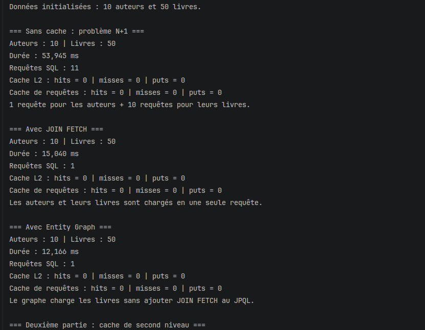
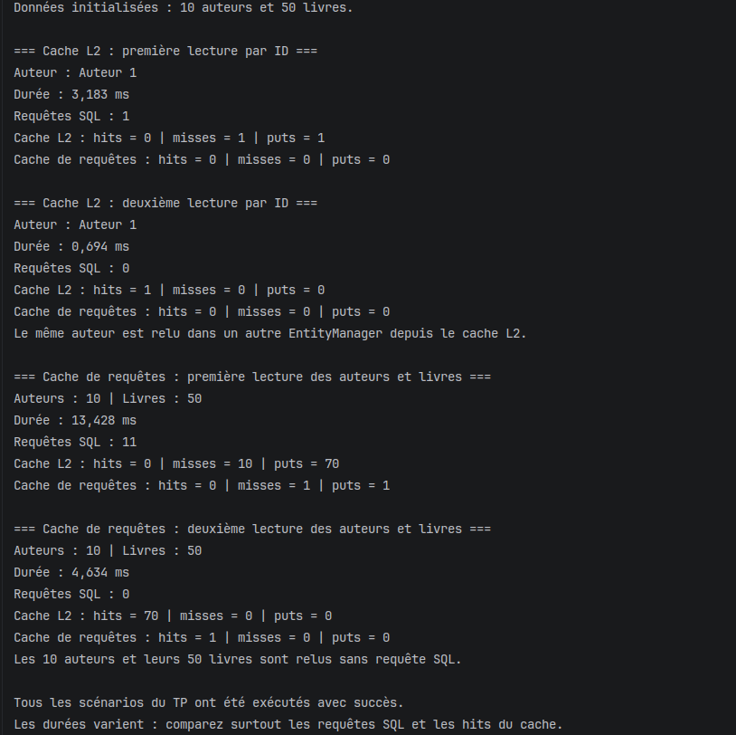

# TP7 — Cache de second niveau et optimisation des performances

Ce TP utilise JPA, Hibernate, H2 et Ehcache pour comparer les accès à la base avec 10 auteurs et 50 livres. Les démonstrations sont exécutées depuis `App.java`.

## Problème N+1, JOIN FETCH et Entity Graph

Sans optimisation, le chargement nécessite 11 requêtes SQL : une pour les auteurs et dix pour leurs livres. Avec `JOIN FETCH`, une seule requête récupère les auteurs et leurs livres. L’Entity Graph obtient aussi ce résultat en précisant les associations à charger sans ajouter de jointure dans le JPQL.

## Cache de second niveau et cache de requêtes

La première lecture d’un auteur par son identifiant exécute une requête SQL. La deuxième utilise le cache de second niveau dans un autre `EntityManager` : aucune requête SQL et un hit du cache. Pour la liste complète, les caches de requêtes, d’entités et de collections permettent de relire les 10 auteurs et leurs 50 livres sans requête SQL. Les durées peuvent varier ; le nombre de requêtes et les hits confirment l’utilisation du cache.
